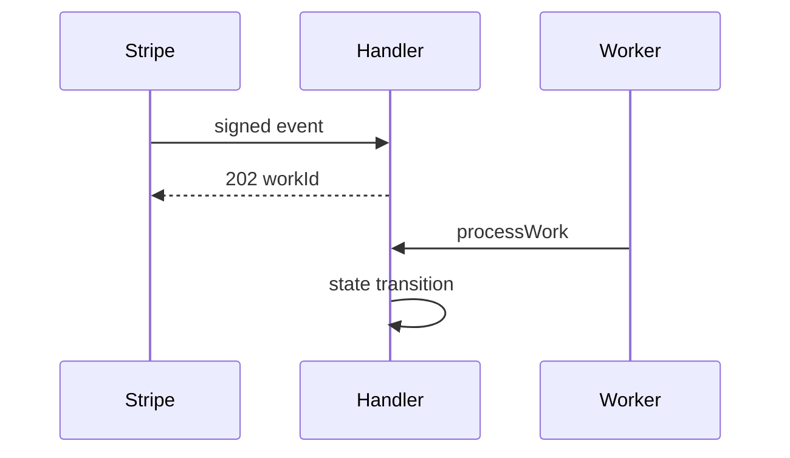

# stripe-payments-ledger — accept now, apply later

[](https://github.com/marchikx/stripe-payments-ledger/actions/workflows/ci.yml)

**Problem it attacks:** Stripe webhooks processed on the request thread → timeouts, double charges, tangled retries.  
**Shape:** verify signature → append idempotent ledger → return **202** + `workId` → `processWork` applies payment state.

**See it:** button “Accept a payment” on https://marchikx.github.io/ops-hq-demo/

```bash
npm install && npm run verify
```

Exports `createWebhookHandler`, `createEventLedger`, `createPaymentStateMachine`, memory `LedgerStore` / `WorkStore`, and fixtures under `fixtures/`.



MIT · Hire: https://github.com/marchikx/marchikx/issues/new?template=hire.md
