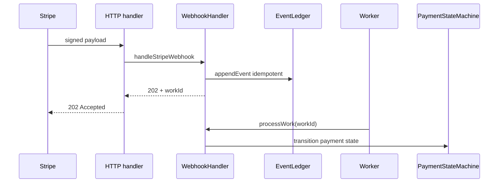

# stripe-payments-ledger

Small TypeScript library for Stripe-style webhooks: verify signatures, append an idempotent in-memory event ledger, acknowledge with HTTP 202, and apply payment state transitions in a background worker step.

## Why this exists

Production payment stacks usually split webhook ingestion from side effects. This package shows that pattern in a testable, dependency-free core: HMAC verification, deduplicated events, async handoff, and a explicit payment state machine.

## Demo

Run `npm run verify` — Vitest exercises webhook verify → ledger append → `202` handoff → `processWork` state transitions (console-free; pass/fail is the demo).

## Architecture



## Features

- **Idempotent ledger** — duplicate Stripe event IDs are ignored on append
- **Payment state machine** — `created` → `requires_action` → `paid` | `failed` | `refunded` | `disputed`
- **Webhook flow** — verify signature, persist event, return `{ status: 202, workId }`, then `processWork(workId)` updates state
- **Reconciliation** — compare expected paid payment IDs against ledger events

## Install

```bash
npm install
```

Requires Node 20+.

## Quick start

```typescript
import {
  createEventLedger,
  createPaymentStateMachine,
  createWebhookHandler,
  reconcile,
} from "./src/index.js";

const ledger = createEventLedger();
const stateMachine = createPaymentStateMachine();
const webhooks = createWebhookHandler(ledger, stateMachine);

// In your HTTP handler (raw body string, Stripe-Signature header, webhook secret):
const { status, workId } = webhooks.handleStripeWebhook(
  rawBody,
  signatureHeader,
  process.env.STRIPE_WEBHOOK_SECRET!
);
// Respond with status 202 immediately

// In your worker:
const { paymentId, state } = webhooks.processWork(workId);

const report = reconcile(["pi_abc", "pi_def"], ledger);
```

## API overview

| Module | Responsibility |
|--------|----------------|
| `createEventLedger()` | `appendEvent`, `getEvent`, `listEvents` (idempotent by event `id`) |
| `createPaymentStateMachine()` | `transition`, `getState` — throws on illegal edges |
| `createWebhookHandler(ledger, sm)` | `handleStripeWebhook`, `processWork` |
| `reconcile(expectedPaidIds, ledger)` | `{ matched, missing, extra }` |
| `signStripePayload` / `verifyStripeSignature` | Stripe-compatible HMAC helpers (tests & tooling) |

Supported Stripe event types mapped to transitions include `payment_intent.requires_action`, `payment_intent.succeeded`, `payment_intent.payment_failed`, `charge.refunded`, and `charge.dispute.created`.

## Development

```bash
npm run verify
```

Runs TypeScript checking and Vitest.

## CI

GitHub Actions runs `npm ci` and `npm run verify` on push and pull requests.

## License

MIT — see [LICENSE](LICENSE).

## Hire me

If your team needs to **add an idempotent Stripe ledger to our app** — webhook verification, deduplicated event storage, and safe payment state transitions — this repo is a concrete starting point. I can adapt the pattern to Postgres, Redis queues, and your existing Stripe integration.
